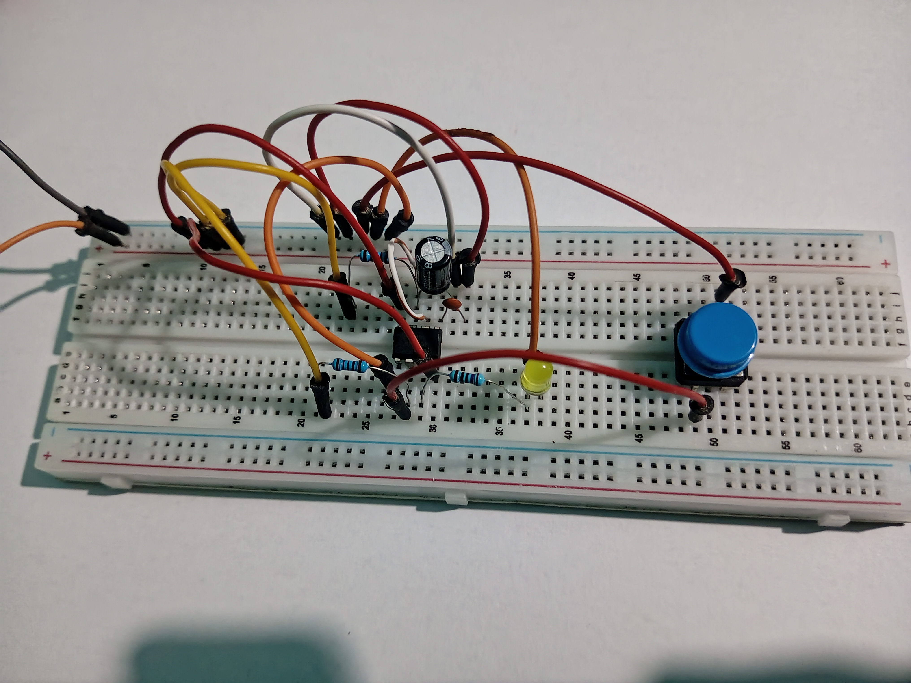

# 555 Timer Monostable Multivibrator

A practical exploration of the **555 timer IC in monostable mode**, using Proteus simulation to study its operation, timing behavior, and trigger circuitry.

This project explores two implementations:

1. **Direct-trigger monostable** — a basic circuit triggered by a push button.
2. **AC-coupled monostable** — an improved trigger circuit designed to produce a short trigger pulse, even when the push button is held down.

Both circuits demonstrate how the 555 timer uses internal comparator thresholds and a latch to control an output pulse.

## 🎯 Project Objectives

- Understand the operation of a 555 timer in monostable mode.
- Explore the trigger and threshold inputs.
- Understand the roles of the timing resistor and capacitor.
- Observe how holding a push button affects the output.
- Investigate AC coupling as a method of producing a temporary trigger signal.
- Compare the behavior of direct-trigger and AC-coupled circuits.

## 🧰 Tools and Components

**Software:** Proteus Design Suite

**Main component:** NE555 timer IC

Other components used in the circuits include:

- Resistors
- Capacitors
- Push button
- Diode (AC-coupled version)
- DC power supply

Refer to the individual Proteus schematics for the exact component values and connections.

---

## 1. Direct-Trigger Monostable

### Circuit

The first implementation connects the push button directly to the trigger input, pin 2, with a pull-up resistor keeping the input HIGH when the button is released.

**Proteus simulation:** `Direct-Trigger/`

### How It Works

The 555 timer contains two comparators and an internal SR latch. These control the output according to the trigger and threshold voltages.

For a supply voltage $\(V_{CC}\)$, the key thresholds are:

- Trigger threshold: approximately $\frac{1}{3}V_{CC}$
- Threshold input level: approximately $\frac{2}{3}V_{CC}$

The sequence of operation is:

1. **Idle state:** Pin 2 is HIGH, the output is LOW, and the timing capacitor is discharged.
2. **Button pressed:** Pin 2 is pulled below $\frac{1}{3}V_{CC}$, setting the internal latch and driving the output HIGH.
3. **Timing interval:** The discharge transistor at pin 7 turns OFF, allowing the timing capacitor to charge through the timing resistor.
4. **Threshold reached:** When the capacitor voltage rises above approximately $\frac{2}{3}V_{CC}$, the threshold comparator resets the latch and the output returns LOW.
5. **Discharge:** The discharge transistor turns ON and discharges the timing capacitor through pin 7.

### What Happens When the Button Is Held?

The trigger input is **level-sensitive**, not simply edge-sensitive. If the button keeps pin 2 LOW, the trigger comparator continues requesting the set state.

Consequently, the circuit may not terminate the output pulse as expected when the timing capacitor reaches its threshold. The output can remain HIGH until the trigger is released, depending on the trigger duration and circuit conditions.

This demonstrates an important distinction: the timing network determines the nominal pulse duration only when the trigger signal allows the timer to reset normally.

---

## 2. AC-Coupled Monostable

### Circuit

The second implementation adds an AC-coupled trigger network consisting of a coupling capacitor, pull-up resistors, and a clamp diode.

**Proteus simulation:** `AC-Coupled-Trigger/`

### Why Add AC Coupling?

The objective is to make the trigger input respond to the **change in the button's voltage**, rather than remain LOW for as long as the button is pressed.

A capacitor blocks steady-state DC while allowing voltage changes to produce transient signals in the surrounding circuit.

### How It Works

1. **Idle state:** The pull-up resistors establish the normal HIGH voltage levels in the trigger network.
2. **Button pressed:** The sudden voltage drop on one side of the coupling capacitor is coupled to the trigger side, producing a brief LOW pulse at pin 2.
3. **Trigger recovery:** While the button remains pressed, the trigger-side pull-up resistor brings pin 2 back HIGH as the transient decays.
4. **Timing interval:** The timing capacitor charges through the timing resistor while the output remains HIGH.
5. **Threshold reached:** When the timing capacitor reaches approximately $\frac{2}{3}V_{CC}$, the threshold comparator resets the latch and the output returns LOW.
6. **Button released:** The rising voltage creates another transient through the coupling capacitor. The clamp diode limits the positive overshoot at the trigger node.

### Component Roles

| Component | Function |
|---|---|
| Coupling capacitor | Transfers voltage changes to the trigger node while blocking steady-state DC. |
| Trigger-side pull-up resistor | Restores the trigger input to HIGH and provides a discharge/recovery path for the coupling network. |
| Switch-side pull-up resistor | Establishes the switch-side voltage when the button is released. |
| Clamp diode | Limits the positive trigger-node overshoot by conducting toward the positive supply rail. |
| Timing resistor | Controls the charging current of the timing capacitor. |
| Timing capacitor | Determines the main output pulse duration together with the timing resistor. |

The diode is not responsible for setting the output pulse duration. Its purpose is to protect the trigger node from the positive transient generated when the button is released.

---

## 3. Understanding the Timing

For a conventional 555 monostable, the approximate output pulse duration is:

$$
t \approx 1.1RC
$$

Where:

- $t$ is the output pulse duration in seconds.
- $R$ is the timing resistance in ohms.
- $C$ is the timing capacitance in farads.

For example, using a timing resistor of $10\,k\Omega$ and a timing capacitor of $100\,\mu F$:

$t \approx 1.1(10{,}000)(100 \times 10^{-6})$

**\boxed{t \approx 1.1\text{ seconds}}**

This is an illustrative example; use the actual timing-component values from each schematic when calculating the expected duration.

The AC-coupled trigger network has its own transient and recovery behavior. Its component values affect the trigger pulse and recovery time, while the main timing resistor and capacitor determine the nominal output pulse duration.

---

## 4. Circuit Comparison

| Feature | Direct Trigger | AC-Coupled Trigger |
|---|---|---|
| Trigger method | Button directly pulls pin 2 LOW | Capacitor couples a brief LOW transient to pin 2 |
| Response to a held button | Trigger may remain active | Trigger can recover HIGH while the button is held |
| Timing behavior | Can be affected by trigger duration | Better suited to a pulse determined by the timing network |
| Positive release transient | No added clamp in the basic version | Clamp diode limits positive overshoot |
| Circuit complexity | Simpler | Additional components and transient behavior |

## 5. Key Concepts Learned

- The 555 timer uses comparator thresholds at approximately one-third and two-thirds of the supply voltage.
- The internal latch stores the output state between triggering and threshold events.
- Pin 7 controls the discharge of the timing capacitor.
- A monostable produces a temporary output pulse in response to a trigger.
- A sustained LOW trigger can interfere with normal timing behavior.
- AC coupling converts a voltage transition into a transient signal.
- Pull-up resistors restore defined DC levels in the trigger network.
- A diode can clamp a transient that rises above the positive supply rail.

## 📁 Project Files

The repository contains Proteus project files for both implementations:

- **Direct-Trigger:** Basic 555 monostable with a push-button trigger.
- **AC-Coupled-Trigger:** Monostable with a transient-coupled trigger network and clamp diode.

Open the corresponding project in Proteus to inspect the circuit and reproduce the simulations.

## Conclusion

This project demonstrates that designing a monostable is not only about choosing the correct timing resistor and capacitor. The trigger circuit also matters.

The direct-trigger implementation reveals what can happen when the trigger remains LOW, while the AC-coupled implementation demonstrates how a transient trigger network can allow the timing circuit to complete its pulse even when the button is held down.

The simulations provide a practical introduction to comparator thresholds, latches, RC timing, AC coupling, and diode clamping in the 555 timer IC.